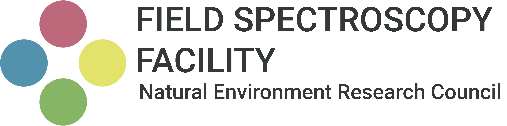

<p align="center">
  
</p>

# NERC FSF Calibration and Characterisation Protocols

Laboratory protocols and processing code used by the [NERC Field Spectroscopy Facility](https://fsf.nerc.ac.uk) (FSF) to calibrate and characterise optical instrumentation for environmental science.

Each protocol describes the test setup, measurement procedure, data processing, and uncertainty analysis for a class of instrument, illustrated with a worked example on FSF equipment. Each is accompanied by open-source code that implements its data processing.

[](https://doi.org/10.5281/zenodo.XXXXXXX)

## Protocols

| Protocol | Instruments | Document | Code | Status |
|---|---|---|---|---|
| [Calibration and Characterisation of Hyperspectral Imagers](protocols/hyperspectral-imagers) | Pushbroom hyperspectral imagers, VNIR–SWIR (350–2500 nm) | [PDF](protocols/hyperspectral-imagers/document/main.pdf) | [Python](protocols/hyperspectral-imagers/code) | Released, Public |
| Calibration and Characterisation of Field Spectrometer Suite | Full range field spectrometers | — | — | In Development, Private |
| Calibration and Characterisation of Bio-Optical Marine Suite | Hyperspectral ocean colour radiometers | — | — | In Development, Private |
| Calibration and Characterisation of Solar Induced Fluorescence Suite | SIF spectrometers and imagers | — | — | In Development, Private |
| Calibration and Characterisation of Thermal Suite | Thermal imagers and infrared radiometers | — | — | In Development, Private |

Further protocols will be added as they are developed.

### Calibration and Characterisation of Hyperspectral Imagers

Based on the work of the IEEE P4001 Working Group, this protocol covers:

- **Spectral domain**: spectral response function characterisation with a monochromator, and spectral calibration with emission line sources.
- **Radiometric domain**: radiometric calibration against an integrating sphere radiance source, the photon transfer curve, A\*, and noise equivalent spectral radiance.
- **Imaging imperfections**: co-registration errors and bad pixel mapping.
- **Uncertainty analysis**: a GUM-based uncertainty budget for the radiometric calibration.

The worked example uses a Headwall Co-Aligned VNIR-SWIR Hyperspectral Imager. The accompanying code is instrument-agnostic and reads ENVI-format datacubes.

## Repository structure

```
protocols/
└── <instrument-class>/
    ├── document/   LaTeX source and compiled PDF of the protocol
    └── code/       Processing code implementing the protocol
```

## Using the code

The code requires Python 3.10 or later. Install the dependencies with:

```
pip install -r requirements.txt
```

Each script contains a configuration block in which the paths to your datacubes and reference data are set. See the relevant protocol for the measurements the code expects.

## Citing

The DOI above always resolves to the latest version of this repository. To cite the protocols:

> Ramsay, R. *NERC FSF Calibration and Characterisation Protocols*. NERC Field Spectroscopy Facility. Zenodo. https://doi.org/10.5281/zenodo.XXXXXXX

Each release also has its own version-specific DOI, listed on the Zenodo record. Use it when you need to cite the exact version you used.

## Versioning

The protocols are living documents and will be revised as methods and facility equipment develop. Each release is archived on Zenodo. Changes are recorded in the release notes.

## Licence

The protocol documents are licensed under [CC BY 4.0](LICENSE). The code is licensed under the [MIT Licence](LICENSE-CODE).

## Contact

The NERC Field Spectroscopy Facility is based at the University of Edinburgh. For questions about these protocols, calibration services, or instrument loans, see [fsf.nerc.ac.uk](https://fsf.nerc.ac.uk).
